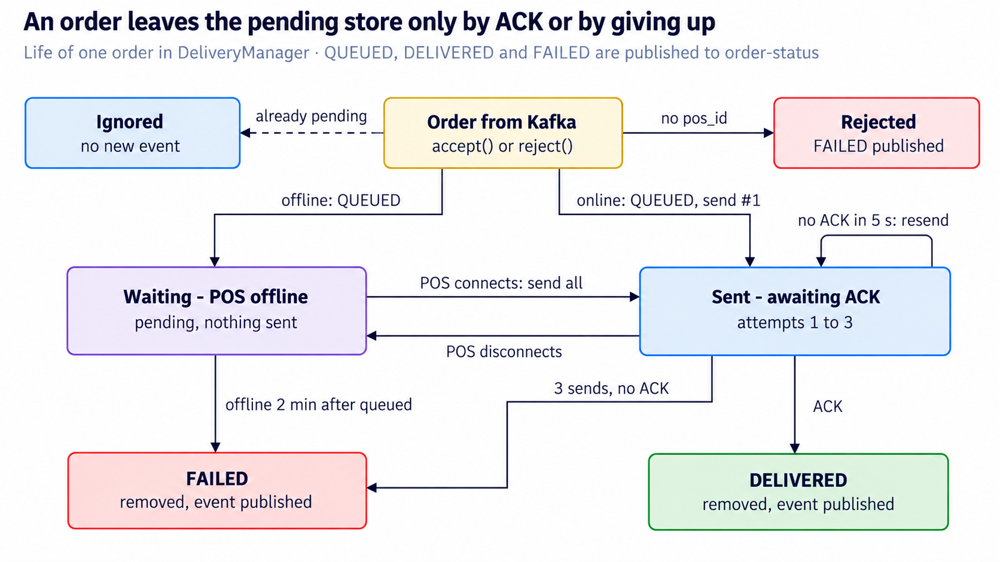
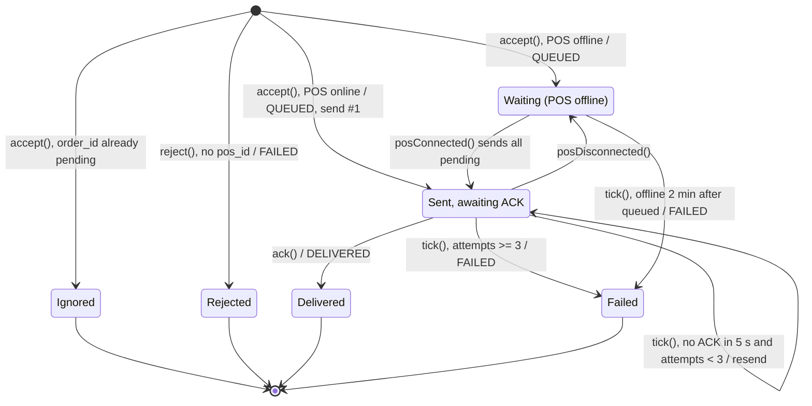

# DeliveryManager: Logical Design

Oct 27, 2026 · @Vincent

## Overview

`DeliveryManager` owns the last hop from Kafka to the POS terminals: it keeps every order pending until its POS sends an ACK, retries or expires the ones that don't, and publishes each outcome to `order-status`. It lives in `src/main/java/com/example/kafka/gateway/DeliveryManager.java` and is the core of `PosGateway`.

State, all in memory:

| Field            | Type                                          | Holds                                                          |
| ---------------- | --------------------------------------------- | -------------------------------------------------------------- |
| `pendingByPos`   | `Map<posId, LinkedHashMap<orderId, Pending>>` | Unacked orders per POS, in Kafka order                         |
| `connections`    | `Map<posId, WebSocket>`                       | The live connection for each POS                               |
| `Pending`        | `order`, `queuedAt`, `attempts`, `lastSentAt` | Per-order delivery bookkeeping                                 |
| `statusProducer` | `KafkaProducer<String, String>`               | Publishes `OrderStatus` to `order-status`, keyed by `order_id` |

Delivery rules:

| Constant       | Value | Rule                                                                           |
| -------------- | ----- | ------------------------------------------------------------------------------ |
| `RETRY_AFTER`  | 5 s   | Resend an order if no ACK arrived within 5 s of the last send                  |
| `MAX_ATTEMPTS` | 3     | After 3 sends with no ACK, give up with FAILED                                 |
| `OFFLINE_TTL`  | 2 min | If the POS stays offline 2 min after the order was queued, give up with FAILED |

Callers, each on its own thread:

| Caller                 | Thread               | Methods                                        |
| ---------------------- | -------------------- | ---------------------------------------------- |
| `PosGateway` poll loop | main (Kafka)         | `accept()`, `reject()`                         |
| `PosWebSocketServer`   | WebSocket I/O        | `posConnected()`, `posDisconnected()`, `ack()` |
| Retry scheduler        | scheduled, every 1 s | `tick()`                                       |

## Logical diagram

An online POS that stays silent fails after about 15 s (sends at 0, 5 and 10 s, give-up at 15 s); an offline POS gets 2 minutes from the moment the order was queued.

The same state machine in Mermaid, for use in READMEs or other docs:

## Method-by-method walkthrough

Every public method is `synchronized`, so the three caller threads never see the maps half-updated.

| Method                         | Trigger                  | What it does                                                                                                                                                       | Status published                                                                         |
| ------------------------------ | ------------------------ | ------------------------------------------------------------------------------------------------------------------------------------------------------------------ | ---------------------------------------------------------------------------------------- |
| `accept(order)`                | Order read from `orders` | If `order_id` is already pending for that POS, logs a redelivery and returns. Otherwise stores a new `Pending`, then sends it if the POS is online.                | QUEUED, with detail "POS online, delivering" or "POS offline, waiting for it to connect" |
| `reject(order, reason)`        | Order without `pos_id`   | Logs and reports it; nothing is stored.                                                                                                                            | FAILED with the reason                                                                   |
| `posConnected(posId, conn)`    | WebSocket opened         | Registers the connection. Closes a different, still-open older connection for that POS with 1008. Sends every pending order for the POS in queue order.            | none                                                                                     |
| `posDisconnected(posId, conn)` | WebSocket closed         | Removes the connection only if it is still the current one, so an old socket closing does not unregister a newer one.                                              | none                                                                                     |
| `ack(posId, orderId)`          | ACK frame from the POS   | Removes the order from the pending queue. An ACK for an unknown or finished order is logged and ignored.                                                           | DELIVERED, "acked by POS after N attempt(s)"                                             |
| `tick()`                       | Scheduler, every 1 s     | For each pending order: POS offline → expire after `OFFLINE_TTL`; sent less than 5 s ago → wait; `attempts >= 3` → give up; otherwise send (retry, or first send). | FAILED on expiry or give-up                                                              |

Private helpers:

- `send(conn, pending)` increments `attempts`, stamps `lastSentAt`, and writes `{"type":"ORDER","order":{...},"attempt":N}` to the connection. A send error is logged; the next `tick()` retries it.
- `publish(order, status, detail)` serializes an `OrderStatus` and sends it to `order-status` with key `order_id`.
- `liveConnection(posId)` returns the connection only if it is open.

## Key design points

- **Pending until ACK, not until sent.** An order leaves the store only through `ack()` (DELIVERED) or `tick()` (FAILED). A successful `conn.send()` proves nothing.
- **Two separate give-up rules.** An online POS that never ACKs fails after 3 sends, about 15 s. An offline POS fails 2 min after the order was queued. The offline clock is checked only while the POS has no live connection.
- **Per-POS order on first delivery.** The pending queue is a `LinkedHashMap`, so orders are sent in the order Kafka delivered them, and reconnects replay the queue in that order.
- **Every outcome becomes an event.** QUEUED, DELIVERED and FAILED go to `order-status` keyed by `order_id`, so all events for one order are ordered on one partition. Kafka itself only knows the gateway's committed offset.
- **Idempotent intake.** Kafka redelivery of an order that is still pending is ignored, which keeps at-least-once from Kafka from producing duplicate pending entries.
- **One lock for everything.** `synchronized` methods serialize the Kafka thread, WebSocket threads and the scheduler on one monitor; simple and correct for a demo, at the cost of throughput.

## Observations and possible improvements

The store is in memory while Kafka already counts its orders as handled, so a crash loses them; the code comment says so. The other items are smaller edge cases found by reading the code.

| Area                  | Current behaviour                                                                                                                                                       | Possible improvement                                                             |
| --------------------- | ----------------------------------------------------------------------------------------------------------------------------------------------------------------------- | -------------------------------------------------------------------------------- |
| Durability            | Pending orders live only in memory; a crash or restart loses every unacked order whose offset is committed                                                              | Persist `Pending` (database, Redis) before the gateway commits                   |
| Attempts on reconnect | `posConnected()` sends every pending order without checking `MAX_ATTEMPTS` or `lastSentAt`, so a flapping POS can get a 4th or 5th attempt, and attempts run out faster | Skip orders at the limit, or reset the retry clock on reconnect                  |
| Order on retry        | All pending orders for a POS are sent at once; a retried earlier order arrives after later ones                                                                         | Send one order at a time per POS (in-flight window of 1) if strict order matters |
| Duplicate memory      | Only pending ids are remembered; a Kafka redelivery after DELIVERED is accepted and sent again                                                                          | Keep recently finished ids for a while, or rely on POS idempotency as now        |
| Empty queues          | A POS's map stays in `pendingByPos` after it empties                                                                                                                    | Remove empty queues in `ack()` and `tick()`                                      |
| Status publishing     | `send()` with no callback; a lost status event is silent                                                                                                                | Add a callback, and set `acks=all` and idempotence on the producer               |
| Locking               | One monitor across all POS terminals; `tick()` scans everything under it                                                                                                | Lock per POS, or move to a single-threaded event loop                            |
