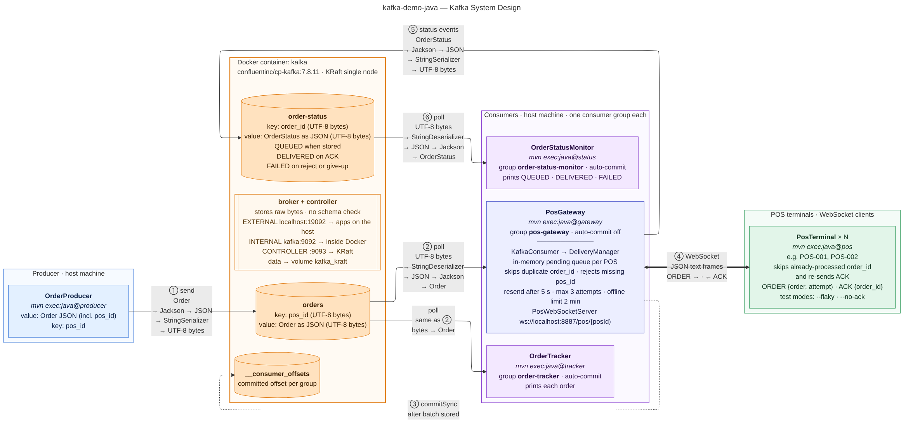
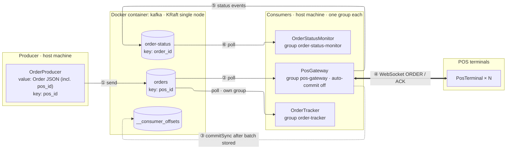

# Kafka POS Demo: Learning Notes

Notes collected while studying the `kafka-demo-java` project: how it is designed, how Kafka fits in, and how to run and test it.
Everything here is checked against the project's code (`src/main/java`), `pom.xml` and `docker-compose.yaml`.

> Last updated: 15 October 2026

---

## 1. What the project does

An `OrderProducer` publishes orders to Kafka. A `PosGateway` reads them and pushes each one to the right POS terminal over WebSocket, retrying when needed. Every outcome (QUEUED, DELIVERED, FAILED) is published back to Kafka, where an `OrderStatusMonitor` prints it. An `OrderTracker` reads the same orders independently.

| Component | Start command | Role |
|---|---|---|
| Kafka (Docker) | `docker compose up -d` | Stores the topics |
| `OrderProducer` | `mvn -q compile exec:java@producer -Dexec.args="POS-001 3"` | Sends orders to `orders` |
| `PosGateway` | `mvn -q compile exec:java@gateway` | Reads `orders`, delivers to terminals, publishes `order-status` |
| `PosTerminal` | `mvn -q compile exec:java@pos -Dexec.args="POS-001"` | Simulated POS (WebSocket client) |
| `OrderStatusMonitor` | `mvn -q compile exec:java@status` | Reads `order-status` and prints outcomes |
| `OrderTracker` | `mvn -q compile exec:java@tracker` | Reads `orders` and prints each order |

Requirements: JDK 17+, Maven 3.9+, Docker.

---

## 2. System design diagram



Source: [`kafka-system-design.mermaid`](kafka-system-design.mermaid)



**Reading the numbers:**

1. **① send:** `OrderProducer` writes an order to `orders`, keyed by POS id.
2. **② poll:** `PosGateway` reads it (consumer group `pos-gateway`).
3. **③ commitSync:** once the batch is stored in its pending queue, the gateway commits its offset. It does **not** wait for the ACK.
4. **④ WebSocket:** the gateway pushes `ORDER` to the terminal, and the terminal answers `ACK`.
5. **⑤ status events:** the gateway publishes QUEUED, DELIVERED or FAILED to `order-status`.
6. **⑥ poll:** `OrderStatusMonitor` reads and prints them.

---

## 3. What Kafka does (and doesn't do)

Kafka is a **durable, ordered log** between the systems that create orders and the systems that deliver them.

**It does:**

- Store every message durably for the retention period (7 days by default), whether or not it has been read.
- Keep the order of messages within a partition. Messages with the same key always go to the same partition.
- Give every message to every consumer group. Each group keeps its own position.
- Remember each group's committed offset (in `__consumer_offsets`).
- Spread partitions across the instances of a group, and move them if one fails (rebalancing).

**It does not:**

- Push messages. Consumers pull with `poll()`.
- Delete messages when they are read.
- Know whether a message was processed, or reached a POS.
- Resend orders to terminals, retry, or deduplicate. That is the gateway's job (see section 7).

> **Rule of thumb:** Kafka's responsibility ends when a consumer group commits its offset. Everything after that belongs to the consumer that committed.

---

## 4. Topics, keys and messages

| Topic | Key | Value | Written by | Read by |
|---|---|---|---|---|
| `orders` | `pos_id` | `Order` as JSON | `OrderProducer` | `PosGateway`, `OrderTracker` |
| `order-status` | `order_id` | `OrderStatus` as JSON | `PosGateway` | `OrderStatusMonitor` |

### Why the POS id appears twice in an order

`OrderProducer` sends `value: Order JSON (incl. pos_id)` and `key: pos_id`.

- **The key** decides the partition, so all orders for one terminal stay in sequence.
- **The `pos_id` inside the JSON** is what the gateway reads (`order.posId()`) to know which terminal to deliver to. Orders without it are rejected as FAILED.

Example `Order`:

```json
{"order_id":"d026929a-…","pos_id":"POS-001","user":"Vincent","item":"New Windows Computer","quantity":1}
```

Example `OrderStatus`:

```json
{"order_id":"d026929a-…","pos_id":"POS-001","status":"DELIVERED","detail":"acked by POS after 1 attempt(s)","timestamp":"2026-10-07T10:15:30.123Z"}
```

### When each status is published

| Status | Published when |
|---|---|
| QUEUED | The gateway stores the order as pending (says whether the POS is online) |
| DELIVERED | The POS sends an ACK |
| FAILED | No `pos_id`, 3 attempts without ACK, or POS offline for more than 2 minutes |

---

## 5. Serialization: Kafka only handles bytes

Kafka stores and sends **bytes only**. It doesn't know about JSON or Java objects. Each client converts in two steps.

**Producer side** (`OrderProducer`, and the gateway's status producer):

1. **Object → JSON text** with Jackson: `MAPPER.writeValueAsString(order)`
2. **Text → UTF-8 bytes** with the configured `StringSerializer` (for both key and value)

**Consumer side** (`PosGateway`, `OrderTracker`, `OrderStatusMonitor`): the reverse.

1. **Bytes → text** with `StringDeserializer`
2. **JSON → object** with Jackson: `MAPPER.readValue(record.value(), Order.class)`

Because the format is only a convention between producers and consumers, all of them must use the same JSON field names. That's why the model classes use `@JsonProperty` with snake_case names (`order_id`, `pos_id`, …).

The WebSocket hop (gateway ↔ terminal) doesn't go through Kafka. It uses JSON text frames:

```
gateway → POS : {"type":"ORDER","order":{...},"attempt":1}
POS → gateway : {"type":"ACK","order_id":"..."}
```

---

## 6. Consumer groups and offsets

### One group per purpose

| Group | Members | Commit mode |
|---|---|---|
| `pos-gateway` | `PosGateway` | Manual (`commitSync` after the batch is stored) |
| `order-tracker` | `OrderTracker` | Automatic (every 5 s by default) |
| `order-status-monitor` | `OrderStatusMonitor` | Automatic |

Each group gets **every** message and keeps its own position. So `OrderTracker` sees every order too, without taking anything away from the gateway. It's a passive observer (like analytics or auditing) and has no part in delivery.

### Why consumers read from offsets

Reading doesn't remove anything from a topic, so each consumer must track how far it has read. There are two kinds of offset:

| | Where it lives | What it's for |
|---|---|---|
| **Current position** | In the consumer's memory | Every `poll()` continues from here |
| **Committed offset** | In Kafka (`__consumer_offsets`) | A saved bookmark, used only when the consumer starts, restarts or takes over a partition |

Why Kafka works this way:

1. **Several readers, one copy:** each group has its own bookmark.
2. **Pick up where you left off:** after a restart, the group resumes from its last committed offset.
3. **The consumer controls its pace:** Kafka never pushes, so a slow consumer isn't flooded.
4. **You can replay:** reset a group's offset or start a new group to read history again.

A **brand-new group** has no bookmark, so `auto.offset.reset = earliest` makes it start from the oldest retained message. That's why a fresh monitor also shows old statuses.

### `poll()` timeout

The value passed to `poll()` (500 ms in the gateway, 1 s elsewhere) is the **maximum wait when there's no data**, not a polling interval. When messages are available, `poll()` returns immediately.

---

## 7. The PosGateway in detail

### Its three roles

1. **Kafka consumer** of `orders` (group `pos-gateway`).
2. **Kafka producer** of `order-status`.
3. **WebSocket server** on `ws://localhost:8887/pos/{posId}`. This part has nothing to do with Kafka.

### Inside it

- **KafkaConsumer:** reads orders, rejects orders without `pos_id`, hands the rest to the DeliveryManager, and calls `commitSync()` after each batch.
- **DeliveryManager:** keeps an **in-memory pending queue per POS** (in Kafka order), skips duplicate `order_id`s, resends after 5 s without ACK, gives up after 3 attempts or 2 minutes offline, and publishes status events.
- **PosWebSocketServer:** accepts terminal connections, reads the POS id from the URL, and turns connect, disconnect and ACK into DeliveryManager calls. It pings every 10 s to detect dead connections.

### Why it commits before the ACK

A consumer group commits **one offset per partition**, meaning "everything before this is done". If the gateway waited for ACKs, one offline terminal would block every other terminal sharing its partition (head-of-line blocking). So the gateway commits as soon as orders are **stored**, and tracks delivery per terminal itself.

### What happens to an ACK

1. The terminal sends `{"type":"ACK","order_id":"…"}` over the WebSocket.
2. `PosWebSocketServer.onMessage` calls `delivery.ack(posId, orderId)`.
3. `DeliveryManager.ack` **removes the order** from that POS's queue and **publishes DELIVERED** to `order-status`.

Kafka only receives a new DELIVERED event. Nothing is "acknowledged back" on `orders`; that offset was committed long before.

### How orders reach a POS that comes back online

Kafka is **not** involved. The gateway decides from its own memory:

1. While the POS is offline, its orders wait in `pendingByPos["POS-001"]`.
2. When the terminal reconnects to `ws://localhost:8887/pos/POS-001`, `onOpen` reads `POS-001` from the URL and calls `posConnected`.
3. `posConnected` sends every pending order for that POS, oldest first.
4. Each stays pending until its ACK arrives. A check every second resends anything without an ACK after 5 s, up to 3 attempts.

```
Kafka "orders" ──poll──▶ PosGateway ──store──▶ pendingByPos["POS-001"] = [A, B]
                          commitSync ✔ (Kafka is done)

... POS-001 reconnects ...
PosGateway ──ORDER A, ORDER B──▶ POS-001
POS-001    ──ACK A, ACK B──────▶ PosGateway ──remove A, B──▶ publish DELIVERED ×2 ──▶ Kafka "order-status"
```

### Who handles each kind of resend

| Situation | Who handles it | How |
|---|---|---|
| POS was offline and reconnects | Gateway | Sends everything pending on reconnect |
| No ACK within 5 s | Gateway | Background check every second, up to 3 attempts |
| POS receives the same order twice | Terminal | Skips it by `order_id`, re-sends the ACK |
| Gateway crashed before `commitSync()` | **Kafka → gateway** | Gateway re-reads the batch on restart; already-pending orders are ignored |

The last row is the only case where Kafka sends something again, and it's to the gateway, not the terminal.

### The big caveat: in-memory store

Once the offset is committed, **the gateway's memory is the only copy of orders still waiting**. If the gateway stops while a POS is offline, those orders are lost, and Kafka won't resend them. A production gateway must keep this queue in a durable store (database or Redis).

### Delivery guarantees

| Hop | Guarantee |
|---|---|
| Producer → Kafka | At least once (producer retries until Kafka confirms) |
| Kafka → gateway | At least once (re-read after crash before commit; duplicates ignored) |
| Gateway → terminal | At least once (resends; terminal deduplicates on `order_id`) |
| End to end | Effectively once at the terminal |

---

## 8. Docker: what runs where

- **Only Kafka runs in Docker.** `docker-compose.yaml` pulls Confluent's ready-made image `confluentinc/cp-kafka:7.8.11` and starts one container named `kafka`.
- **That container is the whole cluster:** a single KRaft node that is both broker and controller (no ZooKeeper).
- **Data survives restarts** in the `kafka_kraft` volume. Only `docker compose down -v` deletes it.
- **All the Java apps run on your Mac** through Maven or IntelliJ.

### Listeners (ports)

| Listener | Address | Used by |
|---|---|---|
| EXTERNAL | `localhost:19092` | Apps on your Mac (set in `KafkaConfig`) |
| INTERNAL | `kafka:9092` | Anything inside Docker, e.g. `docker exec … kafka-topics` |
| CONTROLLER | `:9093` | KRaft internals |

### If you containerised the apps later

- One image of your own (JRE + jar), started with a different main class for each service.
- Kafka and Redis/Postgres stay as official pulled images.
- Data goes in volumes, configuration in environment variables, real POS terminals stay on their own hardware.
- Inside Docker, apps must use `KAFKA_BOOTSTRAP_SERVERS=kafka:9092`, not `localhost:19092`.

Docker isn't shown in a *logical* system design because it doesn't change the data flow; it belongs in a deployment view.

---

## 9. How to run it

Run each component in its own terminal, from the project folder.

### 1. Start Kafka

```bash
cd ~/IdeaProjects/kafka-demo-java
docker compose up -d
docker ps          # a container named "kafka" should be running
```

### 2. Create the topics (recommended)

```bash
docker exec -it kafka kafka-topics --bootstrap-server localhost:9092 --create --if-not-exists --topic orders --partitions 3 --replication-factor 1
docker exec -it kafka kafka-topics --bootstrap-server localhost:9092 --create --if-not-exists --topic order-status --partitions 3 --replication-factor 1
```

With 3 partitions you can see that each POS id always lands on the same partition.

### 3. Terminal A: status monitor

```bash
mvn -q compile exec:java@status
```

Prints `🟢 Status monitor subscribed to order-status`, then waits for events.

### 4. Terminal B: gateway

```bash
mvn -q compile exec:java@gateway
```

Expected:

```
🟢 POS gateway WebSocket listening on ws://localhost:8887/pos/{posId}
🟢 POS gateway consuming orders as group pos-gateway
```

Start it before the terminals. Run only one gateway (port 8887).

### 5. Terminal C: a POS terminal

```bash
mvn -q compile exec:java@pos -Dexec.args="POS-001"
```

Expected: `🟢 POS-001 connected to gateway`.

### 6. Terminal D: send orders

```bash
mvn -q compile exec:java@producer -Dexec.args="POS-001 3"
```

`POS-001` is the target terminal and `3` is how many orders to create. This sends **3 different orders** (each with its own random `order_id`), not the same order 3 times. They all go to the same partition, in order.

What you should see:

- **C (POS):** 3 new orders, an ACK for each.
- **B (gateway):** queued → sent → acked.
- **A (monitor):** QUEUED then DELIVERED for each.

### 7. Optional: Terminal E, the tracker

```bash
mvn -q compile exec:java@tracker
```

---

## 10. Test scenarios

### Offline POS (step by step)

Keep the monitor (A) and the gateway (B) running. **Only stop the POS.** Don't stop the gateway: its pending orders are in memory.

1. **Take the POS offline:** Ctrl+C in terminal C.
   - C: `🔴 POS-001 going offline`
   - B: `[gateway] 🔌 POS-001 disconnected`
2. **Send orders while it's offline:**
   ```bash
   mvn -q compile exec:java@producer -Dexec.args="POS-001 2"
   ```
   - B: `[gateway] 📥 Order … queued for POS-001 (offline)` ×2
   - A: `🕓 QUEUED order …  pos POS-001  (POS offline, waiting for it to connect)` ×2
3. **Optional: Kafka is already done with them:**
   ```bash
   docker exec -it kafka kafka-consumer-groups --bootstrap-server localhost:9092 --describe --group pos-gateway
   ```
   LAG is 0, because the gateway committed after storing the orders.
4. **Bring the POS back within 2 minutes:**
   ```bash
   mvn -q compile exec:java@pos -Dexec.args="POS-001"
   ```
   - B: `[gateway] 🔌 POS-001 connected, 2 pending order(s) to deliver`, then `📤 Sent order …` and `✅ POS-001 acked order …`
   - C: `🧾 [POS-001] New order …` and `👍 [POS-001] ACK sent for …` ×2
   - A: `✅ DELIVERED order …  (acked by POS after 1 attempt(s))` ×2

**Variation, offline too long:** repeat steps 1–2 and wait more than 2 minutes.

- B: `[gateway] ❌ Order … expired: POS-001 stayed offline`
- A: `❌ FAILED order …  (POS offline for more than 120s)`

### Other scenarios

| Scenario | How | What you'll see |
|---|---|---|
| Other terminals aren't blocked | Keep POS-001 off, start `POS-002` and send to it | POS-002 gets its order immediately |
| Lost ACK | Start the POS with `-Dexec.args="POS-001 --flaky"` | Resend after 5 s, duplicate skipped by the POS, then DELIVERED |
| POS never answers | `-Dexec.args="POS-001 --no-ack"` | 3 attempts, then FAILED |

---

## 11. Looking inside Kafka

```bash
# List topics
docker exec -it kafka kafka-topics --bootstrap-server localhost:9092 --list

# Describe a topic and its partitions
docker exec -it kafka kafka-topics --bootstrap-server localhost:9092 --describe --topic orders

# A group's position and lag
docker exec -it kafka kafka-consumer-groups --bootstrap-server localhost:9092 --describe --group pos-gateway

# All messages in a topic
docker exec -it kafka kafka-console-consumer --bootstrap-server localhost:9092 --topic order-status --from-beginning
```

Commands run **inside** the container use port **9092**.

### Stopping

```bash
# Ctrl+C in each terminal, then:
docker compose down      # stops Kafka, keeps the data
docker compose down -v   # stops Kafka and deletes all topics and data
```

---

## 12. Things to remember

- **`docs/RUNNING.md` is out of date.** It describes Homebrew Kafka on `localhost:9092`, Spring Boot and Kafka UI, none of which match the current project.
- **The Python scripts (`producer.py`, `tracker.py`) are not part of this repo.** They're the original crash-course scripts kept in the Claude project. They connect to `localhost:9092`, which isn't reachable from the Mac with this compose file (use `19092`), and `tracker.py` uses the same group as `OrderTracker` (`order-tracker`), so the two would split partitions instead of each seeing every order.
- **No Webcashier, outbox, Redis or DLQ exists in this project.** `OrderProducer` stands in for the real order source. Those pieces are only production ideas.
- **From demo to production:** durable pending store, several gateway instances with routing, persisted processed ids on terminals, TLS and terminal authentication, 3 brokers with replication, exponential backoff and a dead-letter topic, a schema registry, and metrics on lag, pending orders and FAILED rate.

---

## 13. Glossary

| Term | Meaning |
|---|---|
| **Topic** | A named log of messages (`orders`, `order-status`) |
| **Partition** | A slice of a topic; order is guaranteed within it |
| **Key** | Decides the partition; same key → same partition |
| **Offset** | A message's position in a partition |
| **Consumer group** | A set of consumers sharing a position; each group gets every message |
| **Committed offset** | A group's saved bookmark in `__consumer_offsets` |
| **Rebalance** | Kafka moving partitions between a group's members |
| **KRaft** | Kafka's built-in controller (replaces ZooKeeper) |
| **Idempotent** | Processing the same message twice has the same effect as once |
| **Head-of-line blocking** | One stuck message holding up everything behind it |
| **At least once** | Never lost, but may arrive more than once |
