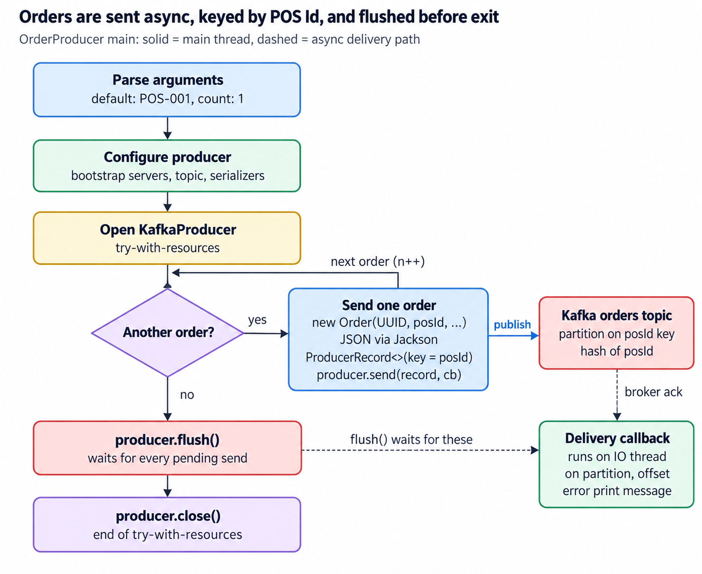
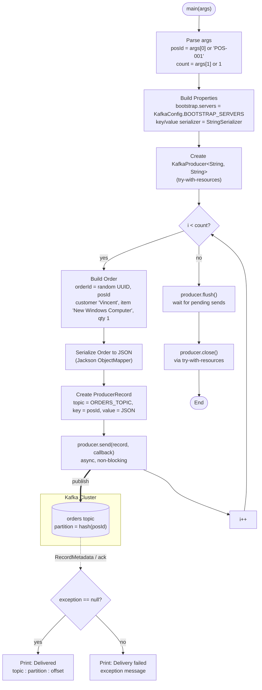

# OrderProducer: Logical Design

Oct 27, 2026 · @Vincent

## Overview

`OrderProducer` publishes order events as JSON to the Kafka `orders` topic, keyed by POS id. It is the Java port of `producer.py` and lives in `src/main/java/com/example/kafka/producer/OrderProducer.java`.

Usage: `OrderProducer [posId] [count]`. Both arguments are optional.

| Argument | Default   | Purpose                                                       |
| -------- | --------- | ------------------------------------------------------------- |
| `posId`  | `POS-001` | Terminal id; used as the message key and stored in each order |
| `count`  | `1`       | Number of orders to send in one run                           |

Broker address and topic name come from `KafkaConfig.BOOTSTRAP_SERVERS` and `KafkaConfig.ORDERS_TOPIC`.

## Logical diagram

The main thread loops once per order and never waits on the broker; acknowledgements come back on the dashed path, and `flush()` holds the exit until all of them have arrived.

The same flow in Mermaid, for use in READMEs or other docs:

## Step-by-step walkthrough

The producer runs once from `main`, sends `count` records asynchronously, then flushes and closes.

1. **Parse arguments.** `posId` falls back to `POS-001`, `count` to `1`.
2. **Configure the producer.** `Properties` set `bootstrap.servers` from `KafkaConfig`, and `StringSerializer` for both key and value.
3. **Open the producer.** `KafkaProducer<String, String>` is created in try-with-resources, so it is closed even if an exception is thrown.
4. **Loop `count` times:**
   1. Build an `Order` with a random UUID, the `posId`, customer `Vincent`, item `New Windows Computer`, quantity `1`.
   2. Serialize it to a JSON string with a shared Jackson `ObjectMapper`.
   3. Wrap it in a `ProducerRecord` with topic `orders`, key `posId`, value the JSON.
   4. Call `producer.send(record, callback)`. The call returns immediately; the record is batched and sent by the producer's I/O thread.
5. **Flush.** `producer.flush()` blocks until every pending record is acknowledged or has failed.
6. **Close.** Leaving the try block calls `producer.close()`, which releases network and thread resources.

## Key design points

- **Keying by `posId` preserves per-terminal order.** Kafka's default partitioner hashes the key, so every order from one POS lands on the same partition and is consumed in send order. Orders from different terminals can interleave.
- **Sends are asynchronous.** `send()` does not wait for the broker. The lambda callback runs later on the producer's I/O thread, playing the role of Python's `delivery_report`.
- **The callback reports the outcome.** On success it prints the JSON plus topic, partition and offset from `RecordMetadata`. On failure it prints the exception message.
- **Flush guarantees completion before exit.** `flush()` waits for all in-flight records, so every callback has fired before `close()`. `close()` would also flush, so the explicit call mirrors `producer.flush()` in the Python version.

## Observations and possible improvements

The producer suits a demo; these gaps matter before using it for real POS traffic.

| Area                | Current behaviour                                            | Possible improvement                                                                                      |
| ------------------- | ------------------------------------------------------------ | --------------------------------------------------------------------------------------------------------- |
| Order content       | Customer, item and quantity are hard-coded                   | Read them from arguments, a file, or a generator                                                          |
| Failure handling    | A failed delivery is only printed; the process still exits 0 | Count failures and exit non-zero, or retry/route to a dead-letter topic                                   |
| Delivery guarantees | `acks`, idempotence and retries are left at client defaults  | Set `acks=all` and `enable.idempotence=true` explicitly so the guarantee doesn't depend on client version |
| Input validation    | A non-numeric `count` throws `NumberFormatException`         | Validate arguments and print usage                                                                        |
| Logging             | `System.out` with emoji markers                              | Use a logger (SLF4J) with levels                                                                          |
| Serialization       | JSON as a plain string                                       | A `JsonSerializer` or schema (Avro/Protobuf with a registry) for typed contracts                          |
