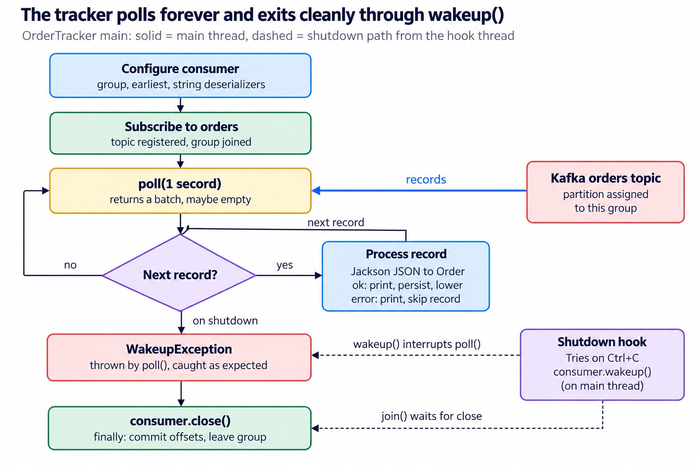
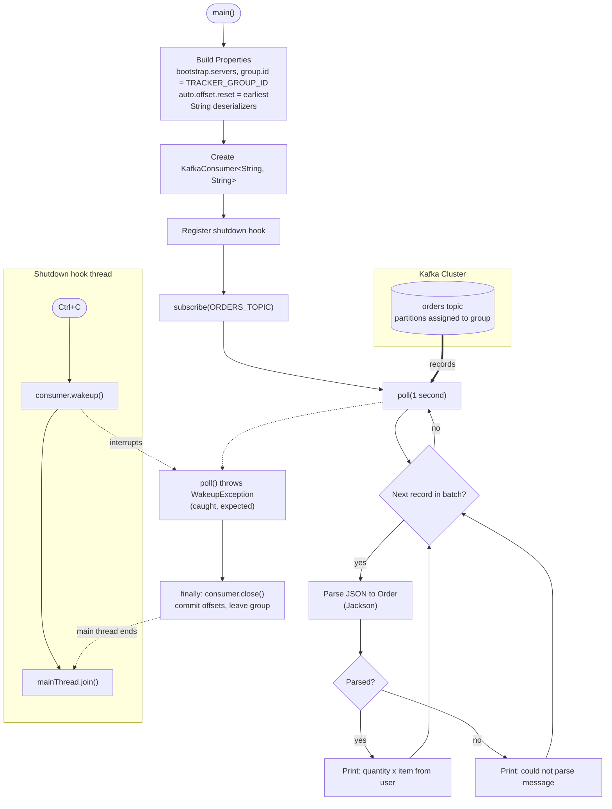

# OrderTracker: Logical Design

Oct 27, 2026 · @Vincent

## Overview

`OrderTracker` consumes order events from the Kafka `orders` topic, parses each JSON value into an `Order`, and prints it. It runs until Ctrl+C. It is the Java port of `tracker.py` and lives in `src/main/java/com/example/kafka/consumer/OrderTracker.java`.

Usage: `OrderTracker` takes no arguments. Settings come from `KafkaConfig` and fixed consumer properties:

| Setting                  | Value                           | Effect                                                                                  |
| ------------------------ | ------------------------------- | --------------------------------------------------------------------------------------- |
| `bootstrap.servers`      | `KafkaConfig.BOOTSTRAP_SERVERS` | Broker to connect to                                                                    |
| `group.id`               | `KafkaConfig.TRACKER_GROUP_ID`  | Consumer group; partitions are shared across instances and offsets are stored per group |
| `auto.offset.reset`      | `earliest`                      | A group with no committed offset starts at the beginning of the topic                   |
| Key / value deserializer | `StringDeserializer`            | Records arrive as strings; JSON parsing happens in the loop                             |
| Topic                    | `KafkaConfig.ORDERS_TOPIC`      | Subscribed with `subscribe()`, so the group coordinator assigns partitions              |

## Logical diagram

The main thread loops between `poll()` and per-record processing with no exit condition; only the shutdown hook's `wakeup()` breaks it, and `join()` keeps the JVM alive until `close()` completes.

The same flow in Mermaid, for use in READMEs or other docs:

## Step-by-step walkthrough

The tracker polls forever on the main thread; a JVM shutdown hook is the only way out of the loop.

1. **Configure the consumer.** `Properties` set the broker, group id, `auto.offset.reset=earliest`, and `StringDeserializer` for key and value.
2. **Create the consumer.** `KafkaConsumer<String, String>` is created outside the try block, so the shutdown hook can reference it.
3. **Register a shutdown hook.** On Ctrl+C the hook prints `Stopping consumer`, calls `consumer.wakeup()`, then joins the main thread so the JVM waits for a clean close.
4. **Subscribe.** `consumer.subscribe(List.of(ORDERS_TOPIC))` joins the group; partitions are assigned on the first poll.
5. **Poll loop (`while (true)`):**
   1. `consumer.poll(Duration.ofSeconds(1))` returns a batch of records, or an empty batch after 1 second.
   2. For each record, Jackson parses the value into an `Order`.
   3. On success it prints quantity, item and user. On any exception it prints a parse error and moves to the next record.
6. **Shutdown.** `wakeup()` makes the blocked or next `poll()` throw `WakeupException`, which is caught and ignored as expected.
7. **Close.** The `finally` block calls `consumer.close()`, which commits offsets (with auto-commit on) and leaves the group so its partitions are reassigned promptly.

## Key design points

- **Consumer group scales reads.** All tracker instances share `TRACKER_GROUP_ID`, so each partition is read by exactly one instance. Running more instances than partitions leaves the extras idle.
- **Per-POS order is preserved.** The producer keys records by `posId`, so one terminal's orders sit in one partition, and a single consumer reads that partition in offset order.
- **Offsets are auto-committed.** No `enable.auto.commit` is set, so the client default (`true`, every 5 s) applies. A crash between commit and processing can skip or replay records, giving at-least-once at best.
- **`earliest` only applies to a new group.** The first run reads the whole topic; later runs resume from the group's committed offset.
- **Bad messages are skipped, not stopped on.** The per-record `try/catch` logs the parse error and continues, so one malformed record does not block the partition.
- **Clean shutdown via `wakeup()`.** `wakeup()` is the only thread-safe `KafkaConsumer` method; it interrupts `poll()` from the hook thread, and `join()` keeps the JVM alive until `close()` finishes.

## Observations and possible improvements

The tracker works as a demo; these gaps matter before it handles real order traffic.

| Area           | Current behaviour                                                        | Possible improvement                                                         |
| -------------- | ------------------------------------------------------------------------ | ---------------------------------------------------------------------------- |
| Offset commits | Auto-commit on a timer, independent of processing                        | Set `enable.auto.commit=false` and `commitSync()` after each processed batch |
| Bad records    | Parse errors are printed and the record is dropped                       | Send failed records to a dead-letter topic with the error                    |
| Error scope    | `catch (Exception)` also hides non-parse failures in processing          | Catch `JsonProcessingException` for parsing; handle other errors separately  |
| Output         | Prints only quantity, item and user; `orderId` and `posId` are not shown | Include `orderId`, `posId`, partition and offset for traceability            |
| Rebalances     | No `ConsumerRebalanceListener`                                           | Commit offsets in `onPartitionsRevoked` once manual commits are used         |
| Logging        | `System.out` with emoji markers                                          | Use a logger (SLF4J) with levels                                             |
