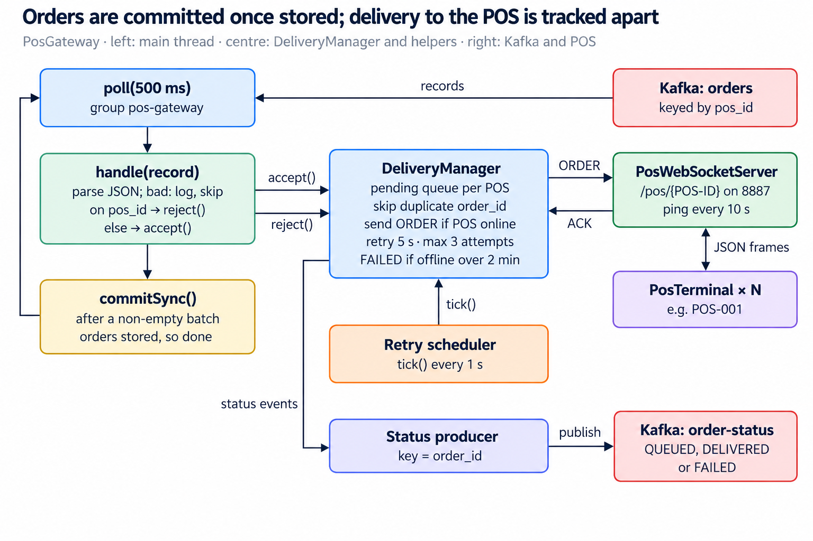
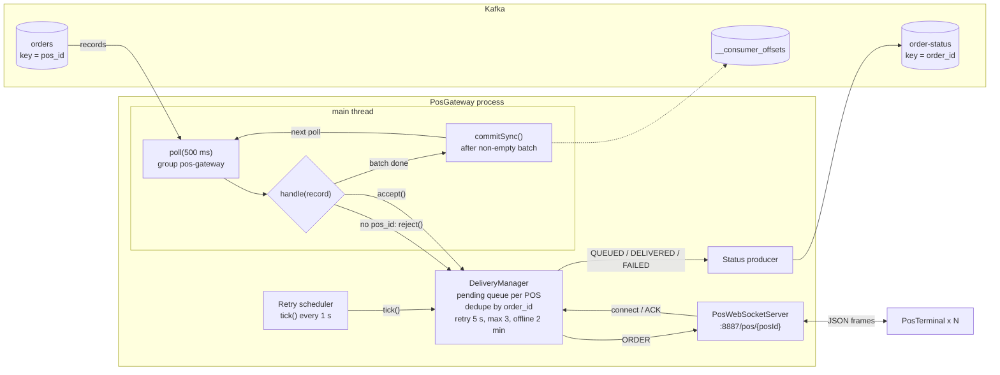

# PosGateway: Logical Design

Oct 27, 2026 · @Vincent

## Overview

`PosGateway` consumes the `orders` topic as group `pos-gateway`, hands each order to `DeliveryManager`, and commits the offset once the order is in the pending store. Delivery to the POS over WebSocket is tracked separately and reported on `order-status`. It lives in `src/main/java/com/example/kafka/gateway/PosGateway.java` and runs with `mvn exec:java@gateway`.

It wires together five parts across four kinds of thread:

| Part                   | Thread                                   | Role                                                                |
| ---------------------- | ---------------------------------------- | ------------------------------------------------------------------- |
| `KafkaConsumer`        | main                                     | Polls `orders` every 500 ms, parses, validates, commits             |
| `DeliveryManager`      | called from all threads (`synchronized`) | Pending queue per POS, send, retry, status events                   |
| `PosWebSocketServer`   | WebSocket I/O threads                    | Accepts `ws://localhost:8887/pos/{posId}`, routes connects and ACKs |
| Retry scheduler        | single scheduled thread                  | Calls `delivery.tick()` every 1 s                                   |
| Status `KafkaProducer` | producer I/O thread                      | Publishes `OrderStatus` to `order-status`, keyed by `order_id`      |

Configuration:

| Setting                 | Value                              | Effect                                                   |
| ----------------------- | ---------------------------------- | -------------------------------------------------------- |
| `group.id`              | `pos-gateway`                      | Own group; gets every order independently of the tracker |
| `enable.auto.commit`    | `false`                            | The gateway commits with `commitSync()` itself           |
| `auto.offset.reset`     | `earliest`                         | A new group starts at the beginning of `orders`          |
| WebSocket port          | `POS_GATEWAY_PORT`, default `8887` | Where POS terminals connect                              |
| Connection-lost timeout | 10 s                               | Pings each POS; drops dead connections                   |

## Logical diagram

The main thread only parses, hands off and commits; everything about reaching the POS (send, ACK, retry, give-up) happens in `DeliveryManager`, driven by WebSocket events and the 1 s scheduler.

The same flow in Mermaid, for use in READMEs or other docs:

## Step-by-step walkthrough

`main` builds the delivery side first, then starts consuming, so no order arrives before the gateway can store and send it.

1. **Status producer.** A `KafkaProducer<String, String>` with `StringSerializer` is created for `order-status` and passed to `DeliveryManager`.
2. **WebSocket server.** `PosWebSocketServer` starts on `GATEWAY_WS_PORT` with `setReuseAddr(true)` and a 10 s connection-lost timeout.
3. **Retry scheduler.** A single-thread scheduler calls `delivery.tick()` every second; exceptions are logged so one bad tick does not kill the schedule.
4. **Consumer and shutdown hook.** The `KafkaConsumer` is created; the hook calls `consumer.wakeup()` and joins the main thread.
5. **Poll loop.** After `subscribe(orders)`, each `poll(500 ms)` batch goes record by record through `handle()`:
   1. Parse the JSON into `Order`. Unreadable records are logged with partition and offset, then skipped.
   2. Missing or blank `pos_id` → `delivery.reject()`, which publishes FAILED.
   3. Otherwise `delivery.accept()`: store as pending, publish QUEUED, send to the POS if it is online.
6. **Commit.** If the batch was non-empty, `consumer.commitSync()` commits it, since every order in it is now stored or rejected.
7. **Shutdown.** `WakeupException` ends the loop; `finally` closes the consumer, stops the scheduler, stops the WebSocket server (1 s timeout), and closes the status producer, flushing pending status events.

## Key design points

- **Commit on store, not on ACK.** The offset is committed once the order is in the pending store. An offline POS therefore never blocks other terminals that share its partition; delivery is tracked by `DeliveryManager` instead of by Kafka.
- **Kafka only knows the hand-off.** The committed offset says "the gateway has it", nothing more. Whether the POS got the order is published on `order-status` as QUEUED, DELIVERED or FAILED.
- **At-least-once from Kafka, deduplicated in the gateway.** A rebalance or restart before `commitSync()` re-delivers the batch; `accept()` ignores an `order_id` that is already pending.
- **Per-POS ordering survives.** Orders are keyed by `pos_id`, so one terminal's orders arrive in offset order, and the pending queue is a `LinkedHashMap` that sends them in that order.
- **Invalid orders fail loudly.** An order with no `pos_id` is not dropped silently; it gets a FAILED status event, so downstream services can see it.
- **Status events are ordered per order.** They are keyed by `order_id`, so QUEUED always precedes DELIVERED or FAILED for the same order on one partition.

## Observations and possible improvements

The gateway's biggest gap is durability: Kafka is told an order is handled while it still lives only in memory.

| Area               | Current behaviour                                                                                                                        | Possible improvement                                                                                                |
| ------------------ | ---------------------------------------------------------------------------------------------------------------------------------------- | ------------------------------------------------------------------------------------------------------------------- |
| Pending store      | In-memory map; a crash or normal shutdown loses every committed but unacked order                                                        | Persist pending orders (database, Redis) before `commitSync()`, as the code comment already requires                |
| Scaling out        | WebSocket connections are local to one instance; with two gateways, a POS connected to A never gets orders from partitions assigned to B | Route by POS (sticky connections matched to partition ownership) or share the pending store and connection registry |
| Deduplication      | Pending `order_id`s live in memory, so after a restart re-delivered orders are sent again                                                | Persist delivered/pending ids; the POS's own idempotency check is the current safety net                            |
| Unreadable records | Logged with partition and offset, then skipped; no status event                                                                          | Publish the raw record to a dead-letter topic                                                                       |
| Status publishing  | `send()` with no callback and default producer settings; a failed status event is silent                                                 | Add a callback, and set `acks=all` and `enable.idempotence=true` explicitly                                         |
| Shutdown order     | Consumer closes first, then scheduler and WebSocket server; in-flight retries stop mid-way                                               | Drain or persist pending orders before stopping the scheduler                                                       |
| Logging            | `System.out` with emoji markers                                                                                                          | Use a logger (SLF4J) with levels                                                                                    |
