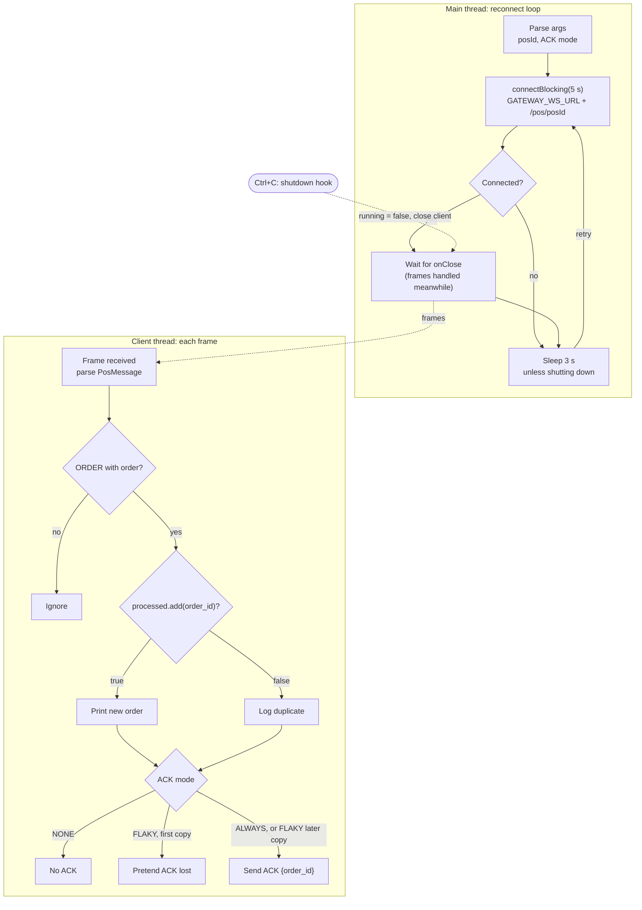

# PosTerminal: Logical Design

Oct 27, 2026 · @Vincent

## Overview

`PosTerminal` simulates a point-of-sale terminal: it connects to `PosGateway` over WebSocket, prints each order it receives, and ACKs it, deduplicating repeats by `order_id`. It lives in `src/main/java/com/example/kafka/pos/PosTerminal.java` and runs with `mvn exec:java@pos`.

Usage: `PosTerminal [posId] [--flaky | --no-ack]`. `posId` defaults to `POS-001`; a first argument starting with `--` is treated as a flag, not an id.

| Mode   | Flag       | ACK behaviour                                         | What it demonstrates                                         |
| ------ | ---------- | ----------------------------------------------------- | ------------------------------------------------------------ |
| ALWAYS | none       | ACK every ORDER, including duplicates                 | Normal delivery; DELIVERED after attempt 1                   |
| FLAKY  | `--flaky`  | Drop the first ACK for each order, ACK later attempts | Gateway retry after 5 s, and the terminal seeing a duplicate |
| NONE   | `--no-ack` | Never ACK                                             | Gateway gives up after 3 attempts and publishes FAILED       |

It connects to `KafkaConfig.GATEWAY_WS_URL + "/pos/" + posId`, which defaults to `ws://localhost:8887/pos/POS-001` and can be overridden with `POS_GATEWAY_URL`. Stopping it with Ctrl+C simulates an offline terminal.

## Logical diagram

Printing is deduplicated, ACKing is not: in the default mode a duplicate is logged and ACKed again, so a lost ACK is always repaired by the gateway's next retry.

The same flow in Mermaid, for use in READMEs or other docs:

## Step-by-step walkthrough

`main` runs a reconnect loop on the main thread; messages are handled on the WebSocket client's own thread.

1. **Parse arguments.** Pick `posId` and the ACK mode (`--no-ack` wins over `--flaky` if both are given).
2. **Build the URI** from `GATEWAY_WS_URL` and `/pos/{posId}`.
3. **Create in-memory sets.** `processed` holds every `order_id` already printed; `ackDroppedOnce` holds the orders whose first ACK was dropped in FLAKY mode. Both are concurrent sets and survive reconnects within one run.
4. **Register a shutdown hook.** On Ctrl+C it prints `going offline`, sets `running` to false and closes the current client.
5. **Reconnect loop (`while running`):**
   1. Create a new `WebSocketClient` and store it in `current`.
   2. `connectBlocking(5 s)`. If it connects, wait on a latch until `onClose` fires, then log `lost connection` if still running.
   3. If still running, wait 3 s and try again. A refused connection (gateway down) goes straight to this retry.
6. **`handleMessage` on each frame:**
   1. Parse the JSON into `PosMessage`; bad JSON is logged and dropped. Anything that is not `ORDER` with an order is ignored.
   2. `processed.add(order_id)` decides first time or duplicate: first time prints `New order ... (attempt N)`; a duplicate prints `already processed, not printing again`.
   3. NONE: log and return without ACK. FLAKY and this is the first ACK for the order: log `pretending the ACK got lost` and return.
   4. Otherwise send `{"type":"ACK","order_id":"..."}`.

## Key design points

- **The POS must be idempotent.** The gateway retries until it sees an ACK, so the same order can arrive several times. The terminal prints it once and still ACKs every copy, so a lost ACK is repaired by the next retry.
- **ACK duplicates, don't ignore them.** If a duplicate were dropped without an ACK, a lost first ACK could never be repaired and the gateway would end with FAILED for an order the POS actually handled.
- **ACK modes are test levers.** FLAKY exercises the retry and duplicate path; NONE exercises the give-up path and FAILED events; Ctrl+C plus restart exercises offline queueing and replay on reconnect.
- **Reconnect forever, 3 s apart.** The loop survives a gateway restart or crash with no operator action, and each reconnect triggers `posConnected()`, which replays the pending queue.
- **Identity is the URL.** The terminal never sends a hello message; `/pos/{posId}` in the connect URL is all the gateway uses.

## Observations and possible improvements

The idempotency set is the piece a real terminal would have to make durable; the rest are simulator refinements.

| Area               | Current behaviour                                                                  | Possible improvement                                                          |
| ------------------ | ---------------------------------------------------------------------------------- | ----------------------------------------------------------------------------- |
| Idempotency memory | `processed` is in memory; after a restart, a retried order is printed again as new | Persist processed `order_id`s; the code comment already says a real POS would |
| Set growth         | `processed` and `ackDroppedOnce` grow for the life of the process                  | Keep a bounded window (by count or age)                                       |
| Ownership check    | Orders are accepted without checking `order.posId()` equals this terminal's id     | Reject and log orders addressed to another POS                                |
| Reconnect timing   | Fixed 3 s retry; many terminals reconnect in lockstep after a gateway restart      | Exponential backoff with jitter                                               |
| Ack timing         | ACK is sent right after printing; there is no real processing that could fail      | Simulate a processing step and ACK only after it succeeds                     |
| Logging            | `System.out` with emoji markers                                                    | Use a logger (SLF4J) with levels                                              |
