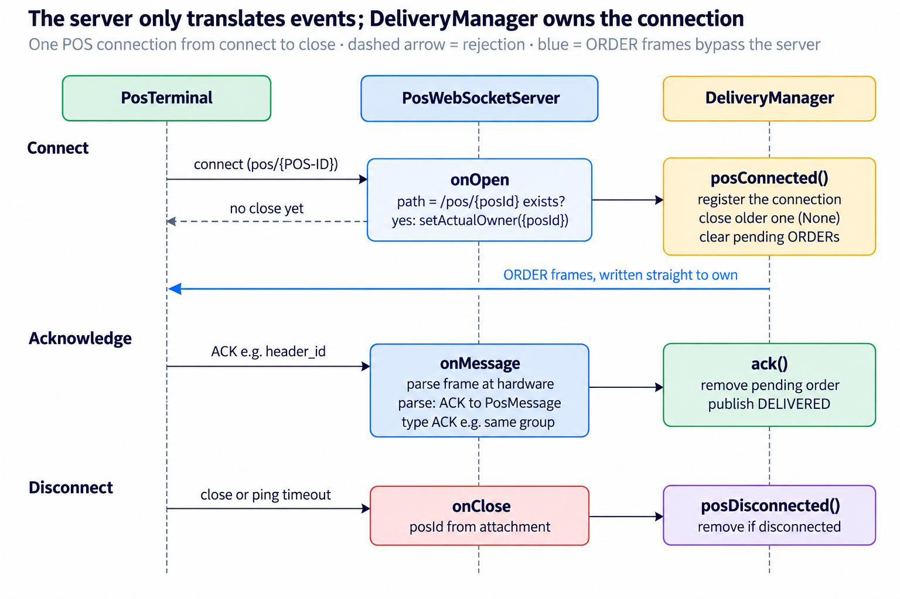
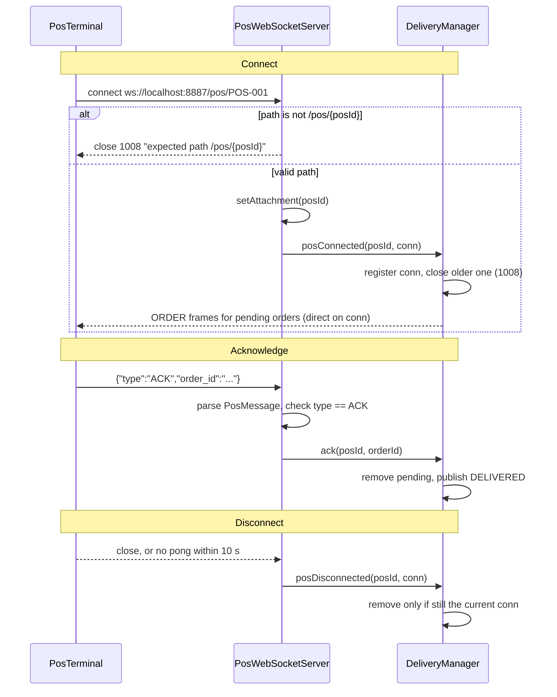

# PosWebSocketServer: Logical Design

Oct 27, 2026 · @Vincent

## Overview

`PosWebSocketServer` is the gateway's WebSocket endpoint for POS terminals: it turns connect, message and close events into `DeliveryManager` calls and holds no delivery logic itself. It extends `org.java_websocket.server.WebSocketServer` (Java-WebSocket) and lives in `src/main/java/com/example/kafka/gateway/PosWebSocketServer.java`. `PosGateway` creates and starts it.

| Aspect                     | Value                                                                                              |
| -------------------------- | -------------------------------------------------------------------------------------------------- |
| Endpoint                   | `ws://localhost:8887/pos/{posId}`; port from `POS_GATEWAY_PORT`, default `8887`                    |
| POS identity               | The `{posId}` path segment, e.g. `/pos/POS-001`                                                    |
| Server → POS               | `{"type":"ORDER","order":{...},"attempt":1}`, sent by `DeliveryManager` on the connection it holds |
| POS → server               | `{"type":"ACK","order_id":"..."}`, handled here                                                    |
| Message format             | JSON text frames, parsed with Jackson into `PosMessage`                                            |
| Settings from `PosGateway` | `setReuseAddr(true)`, connection-lost timeout 10 s (ping/pong)                                     |

The server only receives ACKs. Outbound ORDER frames are written by `DeliveryManager` straight to the `WebSocket` it got from `posConnected()`.

## Logical diagram

Inbound events pass through the server, but outbound ORDER frames do not: `DeliveryManager` keeps the `WebSocket` from `posConnected()` and writes to it directly.

The same flow in Mermaid, for use in READMEs or other docs:

## Event-by-event walkthrough

Each overridden callback maps to one `DeliveryManager` call, or to a log line.

| Callback                              | What it does                                                                                                                                                                                           | DeliveryManager call                                                                                                    |
| ------------------------------------- | ------------------------------------------------------------------------------------------------------------------------------------------------------------------------------------------------------ | ----------------------------------------------------------------------------------------------------------------------- |
| `onStart()`                           | Prints `listening on ws://localhost:<port>/pos/{posId}`                                                                                                                                                | none                                                                                                                    |
| `onOpen(conn, handshake)`             | Reads the request path. If it does not start with `/pos/` or has no id after it, closes with code 1008 and the expected path. Otherwise stores `posId` as the connection's attachment.                 | `posConnected(posId, conn)`: registers the connection, closes an older one for the same POS, flushes its pending orders |
| `onMessage(conn, message)`            | Reads `posId` from the attachment, parses the JSON into `PosMessage`. Acts only on `type == ACK` with a known `posId`; other types are ignored. Parse errors are logged as `Bad message from <posId>`. | `ack(posId, orderId)`: removes the pending order, publishes DELIVERED                                                   |
| `onClose(conn, code, reason, remote)` | Reads `posId` from the attachment; connections rejected in `onOpen` have none and are skipped.                                                                                                         | `posDisconnected(posId, conn)`: removes it only if it is still the current connection                                   |
| `onError(conn, ex)`                   | Logs the error. `conn` is null for server-level errors such as the port already in use.                                                                                                                | none                                                                                                                    |

## Key design points

- **The URL path is the POS identity.** A terminal says who it is by connecting to `/pos/{posId}`; there is no handshake message or authentication.
- **The attachment carries identity across callbacks.** `conn.setAttachment(posId)` in `onOpen` lets `onMessage` and `onClose` know the POS without a lookup table here.
- **A thin adapter, no state of its own.** Connection registry, pending queues and retries all live in `DeliveryManager`; this class only translates events.
- **Thread safety is delegated.** Java-WebSocket calls these callbacks on its own I/O threads; `DeliveryManager`'s methods are `synchronized`, so they are safe alongside the Kafka thread and the retry scheduler.
- **Reconnects replace old connections.** If the same `posId` connects again, `posConnected` closes the previous socket (1008), and the later `onClose` of that old socket does not unregister the new one.
- **Dead connections are detected by ping.** The 10 s connection-lost timeout set by `PosGateway` closes sockets that stop answering pings, which triggers `onClose` and marks the POS offline.

## Observations and possible improvements

The main gap is trust: any client that can reach the port can claim any POS id.

| Area                        | Current behaviour                                                                                                             | Possible improvement                                                 |
| --------------------------- | ----------------------------------------------------------------------------------------------------------------------------- | -------------------------------------------------------------------- |
| Authentication              | None; connecting to `/pos/POS-001` is enough to receive that terminal's orders and ACK them, producing false DELIVERED events | Per-terminal token or mTLS checked in `onOpen` before `posConnected` |
| Bind address                | `new InetSocketAddress(port)` listens on all interfaces, although the log says `localhost`                                    | Bind to a configured host, or `localhost` for the demo               |
| Transport                   | Plain `ws://`                                                                                                                 | `wss://` via `setWebSocketFactory` with an SSL context               |
| posId parsing               | Everything after `/pos/` is taken as is, including a query string or extra slashes (`/pos/POS-001?x=1`)                       | Strip the query, validate against a pattern such as `[A-Za-z0-9-]+`  |
| Unknown message types       | Ignored silently                                                                                                              | Log them, or close with 1003 (unsupported data)                      |
| `onError` with a connection | Logged only                                                                                                                   | Close that connection so the POS reconnects cleanly                  |
| Logging                     | `System.out` with emoji markers                                                                                               | Use a logger (SLF4J) with levels                                     |
