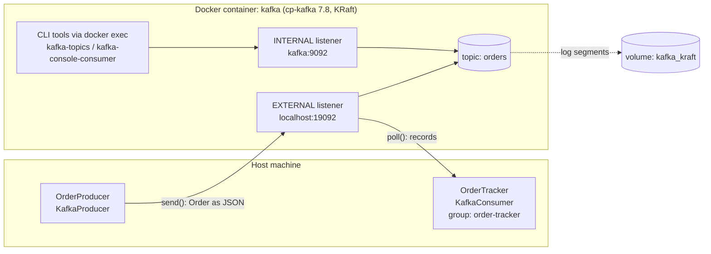
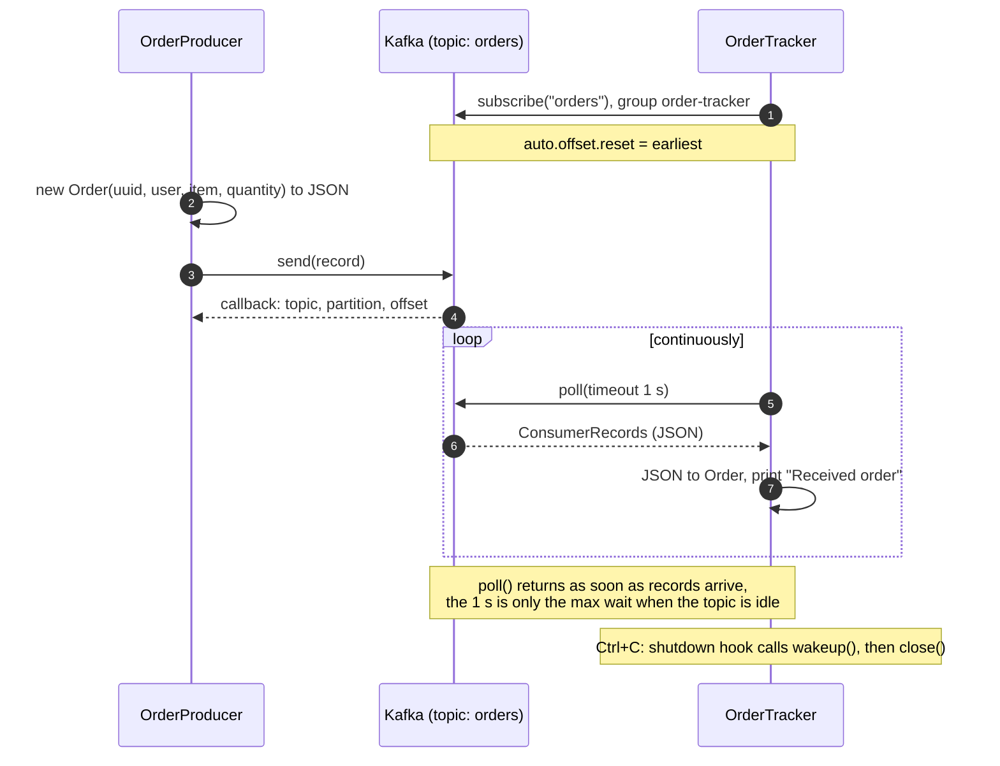

# Architecture

For the POS gateway extension (WebSocket delivery, `order-status` topic), see [pos-gateway.md](pos-gateway.md).

## High-level overview

- **OrderProducer** builds an `Order` (random UUID), serializes it to JSON with Jackson and sends it to `orders`.
- **Kafka** runs as a single KRaft node (broker + controller) in Docker. Host apps use the EXTERNAL listener on `19092`; anything inside Docker (including `docker exec` CLI commands) uses the INTERNAL listener on `9092`.
- **OrderTracker** subscribes to `orders` as consumer group `order-tracker`, calls `poll()` in a loop and prints each order. The `poll()` timeout (1 s) is only the maximum wait when there is no data, not a polling interval.

## Message flow

