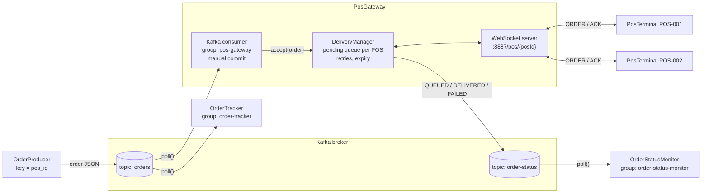
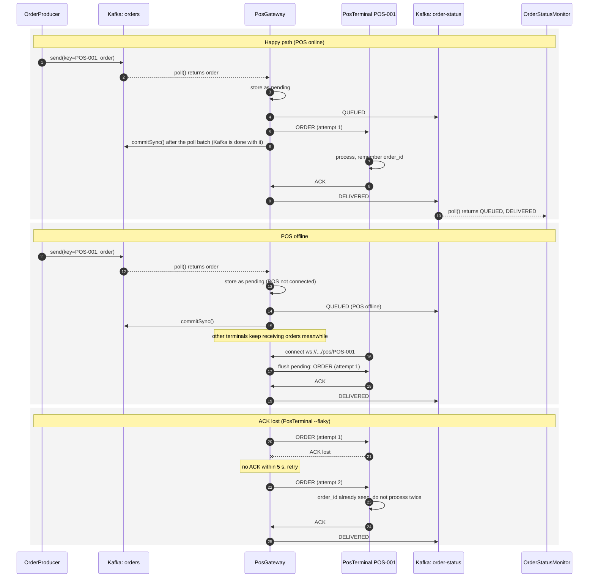
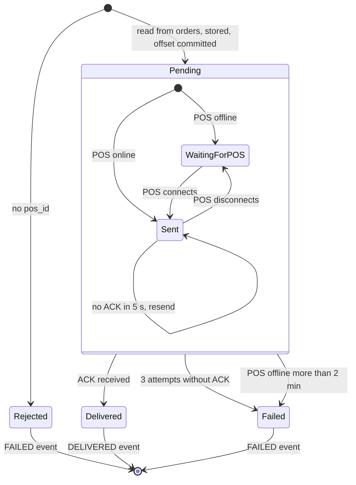

# POS gateway: delivering orders beyond Kafka

Kafka only knows how far each consumer group has read (its committed offset). It never learns whether an order actually reached a POS terminal. The `PosGateway` owns that last hop and reports the outcome as events on the `order-status` topic.

## Components

- `orders` is read by **two independent consumer groups**: `order-tracker` and `pos-gateway`. Each group has its own offsets, so both see every order.
- Orders are keyed by `pos_id`, so all orders for one terminal land on the same partition, in order.
- The gateway **commits the offset once the order is in its pending store**, not when the POS acks. An offline POS therefore never blocks other terminals sharing the partition.
- The gateway publishes every outcome to `order-status`, keyed by `order_id`. Any service (here `OrderStatusMonitor`) can follow delivery from there.

> Demo shortcut: the pending store is in memory. Because the offset is committed when the order is stored, a real gateway must use a durable store (database, Redis...), or a crash would lose orders Kafka already considers handled.

## Message flow

## Life of an order inside the gateway

Every arrow into a final state publishes the matching event on `order-status`. `QUEUED` is published when the order enters `Pending`.

## Delivery guarantees

- **Kafka to gateway: at-least-once.** If the gateway crashes before `commitSync()`, it re-reads the batch. Orders already pending are ignored (deduplicated by `order_id`).
- **Gateway to POS: at-least-once.** Retries mean the POS can receive the same order twice, so the POS must be **idempotent**: it remembers processed `order_id`s and only re-sends the ACK.
- Together these give *effectively once* processing at the POS, which is the realistic target end-to-end.
